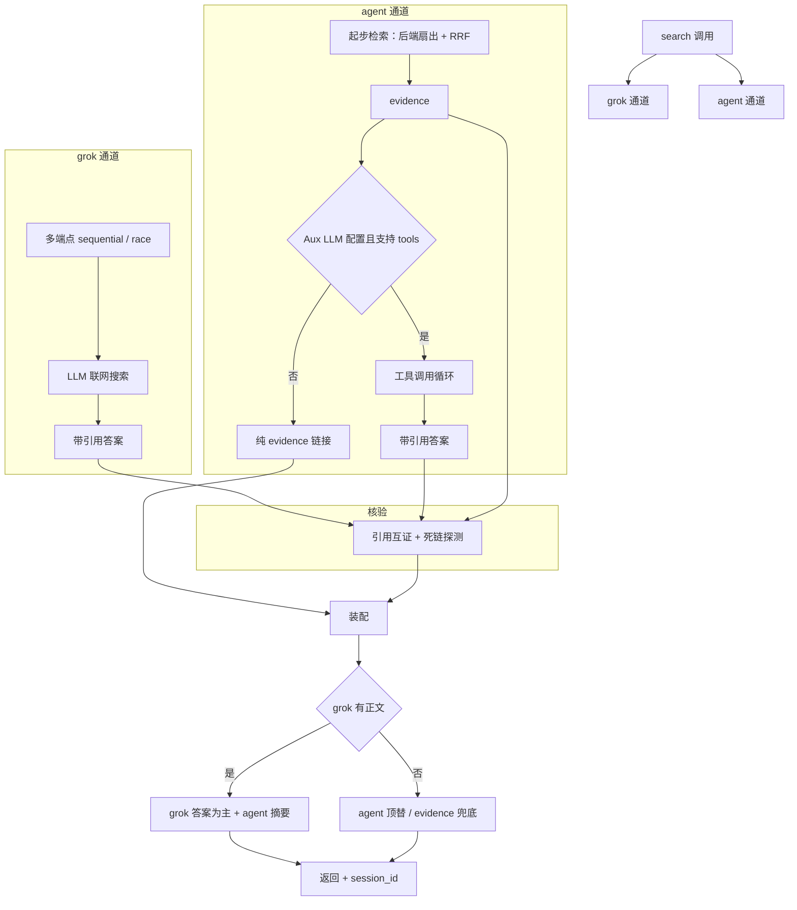

# aether-search

[](https://www.python.org/downloads/) [](https://github.com/jlowin/fastmcp)

aether-search 是一个基于 [FastMCP](https://github.com/jlowin/fastmcp) 的 MCP 搜索服务器，为 MCP 客户端（Claude Code、Cherry Studio 等）提供网络搜索能力，可替代客户端内置的 WebSearch / WebFetch。三个配置维度（grok 端点 / 搜索后端 / Aux LLM）相互独立，**按需启用**——配置哪个即启用哪个，未配置的自动跳过。

---

## 简介

aether-search 把「LLM 联网搜索」与「多后端关键词检索」两条搜索路径整合进一个 MCP 服务器，目标是给 MCP 客户端提供一个**来源可控、可互证、容错**的搜索工具，替代客户端内置的单一来源 WebSearch。

### 背景与问题

MCP 客户端自带的内置搜索通常依赖单一来源，存在单点风险、来源不可控、无法核验等问题：一旦该来源波动或失败，搜索能力即不可用；返回的引用也难以交叉验证可信度。

### 解决方案

aether-search 采用双通道并行架构：

- **grok 通道**调用任意 OpenAI 兼容端点（xAI 官方、OpenRouter、自建中转等），由 LLM 自带联网能力（如 xAI Live Search、OpenRouter `:online`）直接产出带内联引用的 Markdown 答案。
- **agent 通道**扇出多个搜索 API 后端（exa、serper、brave、youcom、tavily 等）获取原始链接（evidence），经 RRF 融合去重；若额外配置了 Aux LLM，则通过工具调用（function calling）让 LLM 在 evidence 基础上自主追加搜索、抓取页面、产出带引用答案。

两通道并行执行，返回后引用跨通道互证——同一 URL 被两路独立命中即更可信；同时对所有展示链接做死链探测。任一通道失败时由另一通道顶替，全部未配置时返回错误提示。

### 适用场景

- 在 MCP 工作流里集成搜索，且不依赖客户端内置的单一来源；
- 复用已有的搜索 API 额度（exa / serper / brave / …）与 LLM 端点；
- 需要 grok 联网搜索与多后端检索互相印证以提升答案可信度。

## 架构

### 双通道工作流



- **grok 通道**：支持配置多个 OpenAI 兼容端点，按 `sequential`（主备）或 `race`（竞速）策略调度；单端点返回空正文或异常时自动切换备用端点。SSE 流式解析 + 非流式 JSON 兜底，`Retry-After` 退避重试。
- **agent 通道**：起步检索无条件扇出已配置后端 + RRF 融合得到 evidence（保证互证有稳定证据池）；若配置了 Aux LLM 且端点支持 function calling，则进入工具调用循环——LLM 自主决定是否调 `search_multi`（追加搜索）或 `fetch_page`（抓取全文）、何时收手写答案；超步数 / 超时 / LLM 异常时用已有 evidence 强制收尾。
- **核验**：两通道返回后，引用做跨通道互证（同一 URL 两路命中标记 ✓ 印证），并对展示链接做死链探测（404 / 410 标 ⚠）。
- **装配**：grok 有正文则 grok 为主、agent 出摘要行；grok 空正文则 agent 顶替；双失败则 evidence 链接兜底；全部未配则返回配置错误。
- **信源缓存**：每次 search 的全部信源（grok 引用 + agent evidence）去重入会话缓存，返回 `session_id`，可由 `get_sources` 拉取。

### 后端分层

9 个搜索后端可划分为主层与补充层：

- **主层**：`search` 默认扇出。
- **补充层**（由 `AETHER_FALLBACK_BACKENDS` 指定，如 `sonar,linkup`）：仅 `search_deep` 显式调用。
- `search` 主层结果偏少（去重后 < `AETHER_TOP_K`）时，输出提示建议上层 agent 调 `search_deep`；是否调用由上层 agent 决定（aether 不自动级联）。
- 用途：把按量付费（sonar）或一次性配额（linkup）的后端从默认扇出移出，避免每次 search 都消耗。

### 模块

| 文件 | 职责 |
|---|---|
| `server.py` | FastMCP 入口；7 个工具、双通道编排、装配降级、进程硬化（SIGINT / Windows 父进程监控） |
| `channels.py` | `GrokChannel`（多端点容灾）+ `AgentChannel`（工具调用循环） |
| `agent.py` | 后端扇出 + RRF 融合；主层 / 补充层拆分；查询改写 |
| `connectors/` | 9 个搜索后端适配（brave / exa / serper / linkup / youcom / sonar / tavily / firecrawl / parallel） |
| `verify.py` | 引用互证 + 死链探测（URL 规范化） |
| `sources.py` | 信源解析（四格式）+ 会话缓存（LRU） |
| `fetcher.py` | 页面抓取（Tavily Extract / Firecrawl Scrape / Tavily Map） |
| `llm.py` | OpenAI 兼容 LLM 客户端 + 工具调用（function calling）+ 不支持自动降级 |
| `config.py` | 配置（`AETHER_*` 环境变量，`.env` 支持，`SSL_CERT_FILE` 自愈） |

### 工具

aether-search 对外暴露 7 个 MCP 工具（即"内置工具"，由上述模块实现、经 stdio 暴露给 MCP 客户端）：

| 工具 | 作用 |
|---|---|
| `search(query, platform="", sources_mode="inline")` | 双通道并行搜索（主层后端扇出）；`sources_mode="session"` 时正文仅保留答案与核验块，信源通过 `get_sources` 获取 |
| `search_deep(query, platform="")` | 补充层检索（sonar / linkup 等配额受限后端）；由上层 agent 根据 `search` 偏少提示决定是否调用 |
| `get_sources(session_id)` | 获取指定会话的全部信源（带 ✓⚠? 核验标记） |
| `web_fetch(url)` | 抓取单页为 Markdown（Tavily Extract → Firecrawl Scrape 降级） |
| `web_map(url, ...)` | 站点结构映射（Tavily Map） |
| `toggle_builtin_tools(action)` | 开关调用方项目 `.claude/settings.json` 中 Claude 内置的 WebSearch / WebFetch（`on` / `off` / `status`） |
| `get_config()` | 配置状态（key 脱敏）+ 逐端点 `/models` 连通性诊断 |

## 特性与局限

### 特性

- **双通道独立信源互证**：grok（LLM 联网）与 agent（多后端检索）走不同搜索路径，同一 URL 被两路命中即印证，提升答案可信度。
- **配置维度独立**：grok 端点、搜索后端、Aux LLM 三个维度互不强制，按需启用；全部未配置时才返回错误。
- **grok 多端点容灾**：支持配置多个 OpenAI 兼容端点，返回空正文或异常时自动切换备用端点；可选 `sequential`（主备）或 `race`（竞速）。
- **9 个搜索后端 + RRF 融合**：exa / serper / brave / linkup / youcom / sonar / tavily / firecrawl / parallel，配置哪个启用哪个；跨后端按 Reciprocal Rank Fusion 去重排序。
- **agent 工具调用**：配置 Aux LLM 后，LLM 自主决定搜索内容、抓取页面、收手时机，把检索证据升级为带引用答案；规划逻辑内化在提示词中。
- **全链路容错**：grok 空正文、agent LLM 异常、端点不支持工具调用、超时等场景均自动降级（顶替 / 兜底 / 收尾），主流程不中断。

### 局限

- **依赖外部 API key**：grok 端点、搜索后端、Aux LLM 均需用户自行申请与配置；项目不内置任何免费额度。
- **agent 工具调用延迟较高**：LLM 多轮调用，单次 search 约 15–50 秒；对延迟敏感的场景可仅启用 grok 通道（单通道约 10–30 秒）。
- **工具调用依赖端点支持 function calling**：Aux LLM 端点须支持 OpenAI 风格 `tools` 参数；不支持时自动降级为证据链接（不出带引用答案）。
- **中转端点稳定性波动**：经第三方中转的 grok 端点可能返回空正文（非 aether 问题），需配置多端点容灾或更换稳定端点（xAI 直连 / OpenRouter）。
- **配额受限后端需手动分层**：按量付费（sonar）或一次性配额（linkup）的后端需通过 `AETHER_FALLBACK_BACKENDS` 归入补充层，否则每次 search 都消耗。
- **无自动化测试**：项目未包含单元 / 集成测试，验证依赖启动检查与真实 key 调用。

### 搜索后端

支持 10 个搜索来源（1 个 grok 主通道 + 9 个 Aux 后端），按需启用：

| 服务 | 角色 | 免费额度 | 起步价（付费） | 申请入口 |
|---|---|---|---|---|
| xAI Grok | 主通道（AI 答案） | 无（按量） | grok-4.5：$2/1M 入 + $6/1M 出；Live Search $0.025/次起 | console.x.ai |
| You.com | Aux | $100 credit（≈20,000 次，无需信用卡） | $5/1k calls | you.com/platform |
| Parallel | Aux（multi_query） | 5,000 次/月 + $5 月度额度 | $1/1k requests | platform.parallel.ai |
| Exa | Aux（语义搜索） | $10/月 + 注册 $20 | $7/1k Search | dashboard.exa.ai |
| Serper | Aux（Google SERP） | 2,500 次（6 个月有效） | $1/1k | serper.dev |
| Linkup | Aux | 4,000 次（一次性） | $0.005–0.006/次 | linkup.so |
| Tavily | Aux + 抓取 | 1,000 credits/月 | $0.008/credit | app.tavily.com |
| Firecrawl | Aux + 抓取 | 1,000 credits/月 | ~$0.00083/credit | firecrawl.dev |
| Brave | Aux（独立索引） | $5/月（需绑信用卡） | $5/1k requests | api.search.brave.com |
| Perplexity Sonar | Aux（LLM 搜索） | 无（需绑卡） | sonar $1/1M 入 + $1/1M 出 + search $5/1k | perplexity.ai |

免费额度排名（建议优先配置顺序）：You.com ≫ Parallel > Linkup（一次性）> Serper > Exa > Tavily ≈ Firecrawl ≈ Brave > Sonar（无）。

### 查询质量排名

[AIMultiple 2026-02 基准](https://aimultiple.com/agentic-search)，8 个 API × 100 真实查询，Agent Score 满分 20：

| 服务 | Agent Score | 质量分 /5 | 相关结果数 | 延迟 | 备注 |
|---|---|---|---|---|---|
| Brave | **14.89（#1）** | 3.49 | 4.26 | **669ms 最快** | 独立索引，综合第一 |
| Firecrawl | 14.58（#2） | 3.72 | **4.30 最高** | 1,335ms | 相关结果最多 |
| Exa | 14.39（#3） | **3.82 最高** | 3.95 | ~1,200ms | 语义检索，质量分第一 |
| Parallel | 第一梯队 | — | — | — | 与前三者差距无意义 |
| Tavily | 13.67（#5） | 3.77 | 3.85 | 998ms | RAG 友好 |

> 其余后端无 AIMultiple 基准：**Serper** 为 Google SERP 透传（质量 ≈ Google）、**Linkup** Verified SimpleQA 92% F-score（亚秒级最准）、**You.com** 与 **Sonar** 为 AI 原生 / LLM 端到端搜索（无标准基准，口碑强）。

## 配置与使用

### 接入方式

通过 MCP 客户端接入，使用 `uvx` 从 GitHub 拉取运行（无需本地克隆）。`uvx` 自动建立隔离 venv、安装依赖、启动 stdio MCP，并自动忽略失效的 `SSL_CERT_FILE`。

`.mcp.json`（完整模板见 [`mcp.json.example`](mcp.json.example)，复制为 `.mcp.json` 填入 key；需先将代码推送到 GitHub）：

```json
{
  "mcpServers": {
    "aether-search": {
      "command": "uvx",
      "args": ["--from", "git+https://github.com/maliaosaide/aether-search", "aether-search"],
      "env": {
        "AETHER_GROK_API_URL": "https://api.x.ai/v1",
        "AETHER_GROK_API_KEY": "...",
        "AETHER_GROK_MODEL": "grok-4.5",
        "AETHER_LLM_API_BASE": "https://api.openai.com/v1",
        "AETHER_LLM_API_KEY": "...",
        "AETHER_LLM_MODEL": "gpt-4o-mini",
        "AETHER_EXA_API_KEY": "...",
        "AETHER_FALLBACK_BACKENDS": "sonar,linkup"
      }
    }
  }
}
```

`env` 字段按需填写（配置即启用，未配置自动跳过）；布尔与数值须以字符串形式书写（如 `"true"`、`"10"`）。

### 配置项

完整字段见 [`.env.example`](.env.example)（与 `config.py` 一一对应）。主要分组：

**grok 通道**（OpenAI 兼容端点）
- `AETHER_GROK_API_URL` / `_API_KEY` / `_MODEL`：单端点配置。
- `AETHER_GROK_ENDPOINTS`：多端点 JSON（`[{"url","key","model?","label?"}]`），设置后覆盖单端点；端点失败（异常 / 空正文）自动切备。
- `AETHER_GROK_FAILOVER`：`sequential`（默认，主备）/ `race`（竞速）。
- `AETHER_GROK_SEARCH_MODE`：xAI Live Search 控制（`auto`/`on`/`off`/`none`），留空则 api.x.ai 自动、其他端点省略。
- `AETHER_GROK_TIMEOUT`：整通道超时（秒，默认 `60`）。

**Aux LLM**（OpenAI 兼容，可选）
- `AETHER_LLM_API_BASE` / `_API_KEY` / `_MODEL`：配置后 agent 通道走工具调用出带引用答案；端点须支持 function calling。
- `AETHER_LLM_REWRITE`：是否将查询改写为子查询（默认 `true`）。

**搜索后端**（agent 通道的 9 信源）
- `AETHER_<NAME>_API_KEY`，NAME ∈ `PARALLEL` / `BRAVE` / `EXA` / `SERPER` / `LINKUP` / `YOUCOM` / `SONAR` / `TAVILY` / `FIRECRAWL`。
- 默认全部进主层；用 `AETHER_FALLBACK_BACKENDS` 把配额受限后端归入补充层。
- Tavily / Firecrawl 同时驱动后端 `/search` 与 `web_fetch` / `web_map` 的抓取；与 grok-search 共存时此处留空以避免重复消耗。

**分层与 agent**
- `AETHER_FALLBACK_BACKENDS`：补充层后端名（逗号分隔，如 `sonar,linkup`）。
- `AETHER_AGENT_MAX_STEPS`：工具调用步数上限（默认 `6`）。
- `AETHER_AGENT_TIMEOUT`：agent 通道整通道超时，含起步检索（默认 `90` 秒）。

**核验与调参**（一般无需修改）
- `AETHER_VERIFY`（默认 `true`）、`AETHER_VERIFY_TIMEOUT`（`2.5` 秒）、`AETHER_TOP_K`（`10`）、`AETHER_RRF_K`（`60`）、`AETHER_MAX_CONCURRENCY`（`8`）等。

后端申请入口与配额见 [`docs/BACKENDS.md`](docs/BACKENDS.md)。

### 使用

接入后，在 MCP 客户端直接调用工具：
- `search(query)`：双通道搜索（主层），返回 grok 答案 + agent 证据 / 答案 + 核验标记 + `session_id`。
- `search_deep(query)`：补充层检索（sonar / linkup），用于 `search` 主层结果不足时。
- `get_sources(session_id)`：取回信源。
- `web_fetch(url)` / `web_map(url)`：抓取页面 / 站点地图。
- `get_config()`：查看配置 + 端点连通性诊断。

## 功能

### 已实现能力

- 双通道并行 + 引用互证 + 死链探测
- grok 多端点主备 / 竞速容灾（空正文自动切备）
- 9 后端 RRF 融合 + 主层 / 补充层分层
- agent 工具调用循环（LLM 自主检索 / 抓取 / 收手）
- 全链路容错降级（grok 空正文→agent 顶替；agent LLM 异常→evidence；工具不支持→证据摘要；超时→强制收尾；双失败→evidence 兜底）
- 信源会话缓存（`session_id` + `get_sources`）
- 进程硬化（SIGINT / SIGTERM + Windows 父进程监控）

### 配置组合

| grok | 后端(≥1) | Aux LLM | 行为 |
|---|---|---|---|
| ✓ | ✓ | ✓ | 双通道 + agent 带引用答案 + 互证 |
| ✓ | ✓ | ✗ | grok 答案 + evidence 链接 |
| ✓ | ✗ | * | 仅 grok |
| ✗ | ✓ | ✓ | agent 带引用答案 |
| ✗ | ✓ | ✗ | agent evidence 链接 |
| ✗ | ✗ | * | 返回配置错误 |

## 许可证

MIT
