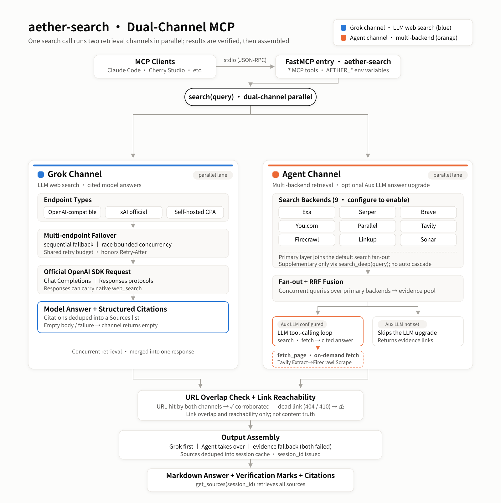

<p align="center">
  
</p>
<h1 align="center">aether-search</h1>
<p align="center">
  <a href="https://www.python.org/downloads/"></a>
  <a href="https://github.com/jlowin/fastmcp"></a>
</p>
<p align="center">
  <strong>English</strong> | <a href="README_CN.md">简体中文</a>
</p>

aether-search is an MCP search server built on [FastMCP](https://github.com/jlowin/fastmcp), providing web search tools for MCP clients (Claude Code, Cherry Studio, etc.). A single `search` call **runs the configured and available channels in parallel**:

- **Grok channel**: calls LLM web search via OpenAI-compatible / xAI / CPA endpoints and produces a cited model answer;
- **Agent channel**: fans out across multiple search API backends (9 optional), fuses and deduplicates results with RRF into an evidence pool; when an Aux LLM is configured it further produces a cited answer through tool calling, otherwise it returns evidence links directly.

The two result sets are cross-corroborated by URL and probed for dead links, then assembled into a single response. The three configuration dimensions (Grok endpoint / search backends / Aux LLM) are independent — each enabled one runs, unset ones are skipped; at minimum configure a Grok endpoint or one primary-layer search backend (the Agent channel stays disabled if every configured backend is assigned to the supplementary layer).

## Architecture



- **Grok channel**: OpenAI-compatible / xAI official / self-hosted CPA endpoints, speaking Chat Completions or Responses through the official OpenAI SDK (Responses can carry the native `web_search`); multiple endpoints support `sequential` (primary/backup) or `race` (bounded concurrent racing), with retries sharing one total deadline.
- **Agent channel**: the seed search unconditionally fans out across all configured primary-layer backends and fuses them with RRF into an evidence pool; if an Aux LLM is configured and the endpoint supports function calling, it enters a tool-calling loop (`search_multi` for additional retrieval, `fetch_page` for full pages), with the LLM deciding when to search and when to stop; on step-limit / timeout / errors it wraps up with the evidence already gathered.
- **Page fetching**: the Agent LLM's `fetch_page` and the `web_fetch` tool share the same fetching implementation (Tavily Extract → Firecrawl Scrape); `web_fetch` / `web_map` (Tavily Map) are independently callable MCP tools, and the Agent's toolset contains no map.
- **Verification**: after both channels return, citations are cross-corroborated (a URL hit by both channels is marked ✓) and displayed links are probed for reachability (404 / 410 marked ⚠); only the links themselves are checked, not content truth.
- **Assembly**: if Grok has body text, Grok is primary with the Agent's retrieved evidence attached; if Grok's body is empty, the agent takes over; if both fail, evidence links serve as fallback; if nothing is configured, a configuration error is returned.
- **Source cache**: all sources (citations + evidence) of each search are deduplicated into a session cache, and a `session_id` is returned that `get_sources` can retrieve.
- **Backend layering**: by default every configured backend joins the primary layer for the `search` fan-out; the supplementary layer named by `AETHER_FALLBACK_BACKENDS` (e.g. `sonar,linkup`) stays out of the default fan-out and is invoked only explicitly by `search_deep` — `search` never cascades to the supplementary layer automatically; when primary results are scarce it only prints a hint, and whether to call `search_deep` is decided by the caller.

## Search Backend Pricing & Quotas

> **Data notes**: this table reflects each vendor's official pricing page as checked on 2026-09-12; a few promotional quotas (e.g. Serper's free count) could not be confirmed on the current pages and are marked in their rows. Always refer to the official pages for current values. Billing units differ across services (per call / per request / per credit / per token) and are not converted into one another.

| Service | Channel role | Free quota | Paid pricing | Billing unit | Official pricing page |
|---|---|---|---|---|---|
| xAI Grok | Primary (LLM answers) | Per vendor / account policy | Billed by the selected model and search tools; prices vary by model / tool | Token + tool calls | [docs.x.ai](https://docs.x.ai/developers/models) |
| You.com | Aux | $100 starting credit; the site also lists a 100 queries/day free entry (this project's connector still requires a key) | Search $5/1k calls (1–100 results same price) | Per call | [you.com/pricing](https://you.com/pricing) |
| Parallel | Aux | Site lists up to 5,000 free requests/month plus signup and monthly credits (up to $80 signup + $5/month; eligibility and stacking rules unspecified) | $1/1k (Turbo/Fast, 10 results); $5/1k (Basic/Advanced); extra results $1/1k results | Per request | [parallel.ai/pricing](https://parallel.ai/pricing) |
| Exa | Aux | $20 signup + $10/month credit | Search $7/1k (10 results included); +$1/1k per extra result | Per request | [exa.ai/pricing](https://exa.ai/pricing) |
| Serper | Aux | Legacy note: 2,500 queries; count and cadence not confirmed on this check, see the signup page | $50/50k credits ($1/1k) entry; higher tiers $0.75–$0.30/1k; credits valid 6 months | Per request (credits) | [serper.dev](https://serper.dev) |
| Linkup | Aux | 4,000 free queries (refresh cadence not stated on the current page) | Search $0.005–0.006/query | Per call | [linkup.so/pricing](https://www.linkup.so/pricing) |
| Tavily | Aux + fetching | 1,000 credits/month | PAYG $0.008/credit | Per credit | [tavily.com/pricing](https://tavily.com/pricing) |
| Firecrawl | Aux + fetching | 1,000 credits/month | Search 2 credits/10 results; paid plans are subscriptions: Hobby $16/month (billed yearly, 5,000 credits), Standard $83/month (billed yearly, 100,000 credits), no pay-as-you-go | Subscription + credit | [firecrawl.dev/pricing](https://www.firecrawl.dev/pricing) |
| Brave | Aux | $5 monthly credit (free plan requires a card for anti-fraud verification) | Search $5/1k requests | Per request | [brave.com/search/api](https://brave.com/search/api/) |
| Perplexity Sonar | Aux | No unified free quota listed on the pricing page | sonar: $1/1M input + $1/1M output; search requests $5 / $8 / $12 per 1k (by low / medium / high search context) | Token + per request | [docs.perplexity.ai](https://docs.perplexity.ai/guides/pricing) |

The Tavily / Firecrawl keys drive both backend retrieval and page fetching for `web_fetch` / `web_map`. For each backend's signup steps and environment variables see [`docs/BACKENDS.md`](docs/BACKENDS.md) (Chinese; recorded 2026-07 — pricing follows the table above).

## Retrieval Quality Reference (Third-Party Benchmark)

> [AIMultiple third-party benchmark](https://aimultiple.com/agentic-search): 100 English AI/LLM-related queries, 5 results taken per API; the source states a **2025-12 evaluation snapshot** (re-checked against the original this round). Agent Score = Mean Relevant × Quality, each out of 5, theoretical maximum 25. These are benchmark scores of **third-party search APIs**; they do not represent aether-search's end-to-end performance or general-domain / Chinese-query retrieval quality.

| API (benchmark's own name) | Mean Relevant /5 | Quality /5 | Agent Score /25 | 95% CI | Latency |
|---|---|---|---|---|---|
| Brave | 4.28 | 3.48 | **14.89** | 13.80–15.93 | 669 ms |
| Firecrawl | 4.30 | 3.39 | **14.58** | 13.12–15.98 | 1,335 ms |
| Exa | 4.32 | 3.33 | **14.39** | 13.25–15.50 | ~1.2 s |
| Parallel (Pro mode) | 4.32 | 3.29 | **14.21** | 13.07–15.47 | 13.6 s |
| Tavily | 4.18 | 3.27 | **13.67** | 12.62–14.76 | 998 ms |
| Parallel (Base mode) | 4.18 | 3.23 | **13.50** | 12.38–14.66 | ~2.9 s |

- Statistical conclusion from the source: no statistically significant difference was found among the top four (Brave / Firecrawl / Exa / Parallel Pro), and Brave's advantage over Tavily is reported as significant.
- External comparators in the benchmark (not integrated by this project): Perplexity Search API 12.96 (11+ s latency), SerpAPI 12.28 (~2.4 s). Note that the Perplexity entry scores its Search API, not this project's Sonar connector; SerpAPI and Serper are different services.
- The table above scores the source's two Parallel modes separately; this project's Parallel connector requests `mode=advanced`, and its mapping to the benchmark's two modes was outside this verification round.
- Backends integrated by this project without comparable scores in this benchmark: You.com, Linkup, Serper, Sonar, Grok.

## Installation & Setup

- Python ≥ 3.11; dependencies `fastmcp` / `httpx` / `openai` / `pydantic` / `tenacity` (see [`pyproject.toml`](pyproject.toml)).
- All configuration is passed via `AETHER_*` environment variables; a `.env` in the runtime working directory also works (not committed).
- At minimum configure a Grok endpoint or one primary-layer search backend key; the Aux LLM and all other fields are optional. The examples below only demonstrate the field format.

### Option 1: Remote repository (uvx)

`.mcp.json` (full template in [`mcp.json.example`](mcp.json.example)). `uvx` pulls and runs the **published remote code** from GitHub; that content is the remote repository's current published state, and it is a separate source from unpushed changes in a local checkout:

```json
{
  "mcpServers": {
    "aether-search": {
      "command": "uvx",
      "args": ["--from", "git+https://github.com/maliaosaide/aether-search", "aether-search"],
      "env": {
        "AETHER_GROK_API_URL": "https://api.x.ai/v1",
        "AETHER_GROK_API_KEY": "<your-key>",
        "AETHER_GROK_MODEL": "<model-id>",
        "AETHER_EXA_API_KEY": "<your-key>"
      }
    }
  }
}
```

### Option 2: Local checkout

Run from a local checkout (the console entry is `aether-search`, i.e. `aether_search.server:main`):

```bash
# uv: resolve dependencies and start inside the repository directory
uv --directory <absolute-repo-path> run aether-search

# Or use Python directly (run from the repository root, adding src to the module path)
PYTHONPATH=src python -m aether_search.server
```

The corresponding `.mcp.json` form:

```json
{
  "mcpServers": {
    "aether-search": {
      "command": "uv",
      "args": ["--directory", "/absolute/path/to/aether-search", "run", "aether-search"],
      "env": {
        "AETHER_GROK_API_URL": "https://api.x.ai/v1",
        "AETHER_GROK_API_KEY": "<your-key>",
        "AETHER_GROK_MODEL": "<model-id>",
        "AETHER_EXA_API_KEY": "<your-key>"
      }
    }
  }
}
```

## Configuration

Full field list in [`.env.example`](.env.example) (one-to-one with `config.py`). Booleans and numbers are written as strings (e.g. `"true"`, `"10"`).

**Grok channel** (OpenAI-compatible / xAI official / CPA)
- `AETHER_GROK_API_URL` / `_API_KEY` / `_MODEL`: single-endpoint setup; the URL includes a version prefix such as `/v1`, and the model name is passed to the upstream as-is.
- `AETHER_GROK_PROVIDER`: `auto` (default) / `openai` / `xai` / `cpa`; auto-detection matches only the exact host `api.x.ai`.
- `AETHER_GROK_API_FORMAT`: `auto` / `chat_completions` / `responses`; under auto, xAI uses Responses and the rest use Chat.
- `AETHER_GROK_ENDPOINTS`: multi-endpoint JSON, each item `url,key,model?,label?,provider?,api_format?,search_mode?`; overrides the single endpoint when set.
- `AETHER_GROK_FAILOVER`: `sequential` (default) / `race`; the race concurrency cap is `AETHER_GROK_MAX_CONCURRENCY` (default `2`).
- `AETHER_GROK_SEARCH_MODE`: empty or `auto` requests native search on xAI and attaches no tools on other gateways; `on` explicitly requests the Responses search tool; `off` / `none` carries no tools (Chat does not support `on`).
- `AETHER_GROK_TIMEOUT` (default `60` s, whole channel) / `AETHER_GROK_REQUEST_TIMEOUT` (default `45` s, per attempt).
- Field details in the [Grok channel documentation (Chinese)](docs/GROK.md).

**Aux LLM** (OpenAI-compatible, optional)
- `AETHER_LLM_API_BASE` / `_API_KEY` / `_MODEL`: when configured, the agent channel produces a cited answer via tool calling; the endpoint must support function calling.
- `AETHER_LLM_REWRITE` (default `true`): whether to rewrite the query into sub-queries.

**Search backends** (9; setting a key enables it)
- `AETHER_<NAME>_API_KEY`, NAME ∈ `PARALLEL` / `BRAVE` / `EXA` / `SERPER` / `LINKUP` / `YOUCOM` / `SONAR` / `TAVILY` / `FIRECRAWL`; URLs all have official defaults.

**Layering / Agent / Verification**
- `AETHER_FALLBACK_BACKENDS`: supplementary-layer backend names (comma-separated), excluded from the default `search` fan-out.
- `AETHER_AGENT_MAX_STEPS` (default `6`), `AETHER_AGENT_TIMEOUT` (default `90` s, including the seed search).
- `AETHER_VERIFY` (default `true`), `AETHER_VERIFY_TIMEOUT` (default `2.5` s).
- Others: `AETHER_FANOUT` / `AETHER_MAX_VARIANTS` / `AETHER_TOP_K` / `AETHER_RRF_K` / `AETHER_MAX_CONCURRENCY` etc., see `.env.example`.

### Configuration Combination Behavior

| Grok | Primary backends (≥1) | Aux LLM | Behavior |
|---|---|---|---|
| ✓ | ✓ | ✓ | Both channels in parallel + cited agent answer + corroboration |
| ✓ | ✓ | ✗ | Grok answer + evidence links |
| ✓ | ✗ | * | Grok channel only |
| ✗ | ✓ | ✓ | Cited agent answer |
| ✗ | ✓ | ✗ | Agent evidence links |
| ✗ | ✗ | * | Configuration error returned |

## MCP Tools

| Tool | Purpose |
|---|---|
| `search(query, platform="", sources_mode="inline")` | Dual-channel parallel search (primary-backend fan-out); with `sources_mode="session"` the body keeps only the answer and verification block, sources are fetched via `get_sources` |
| `search_deep(query, platform="")` | Supplementary-layer retrieval (backends named by `AETHER_FALLBACK_BACKENDS`); called by the upper layer based on the sparse-results hint from `search` |
| `get_sources(session_id)` | Retrieve all sources of a given session (with ✓ ⚠ ? verification marks) |
| `web_fetch(url)` | Fetch a single page as Markdown (Tavily Extract → Firecrawl Scrape fallback) |
| `web_map(url, ...)` | Site structure mapping (Tavily Map) |
| `toggle_builtin_tools(action)` | Toggle Claude's built-in WebSearch / WebFetch in the caller project's `.claude/settings.json` (`on` / `off` / `status`) |
| `get_config()` | Configuration status (keys masked) + per-endpoint `/models` connectivity diagnostics |

## Limitations

- Depends on external API keys: the Grok endpoint, search backends and Aux LLM all require your own signup and configuration; the project bundles no free quota.
- Latency depends on the enabled backends, upstream response speed and Agent tool-calling rounds; the latencies in the benchmark table above are standalone measurements of third-party APIs, not this project's end-to-end times.
- Tool calling requires the Aux LLM endpoint to support OpenAI-style `tools`; when unsupported it tries an LLM digest, then falls back to evidence links.
- Grok endpoints behind third-party relays may return empty bodies; multi-endpoint failover allows configuring backup endpoints.
- Metered or quota-limited backends can be moved to the supplementary layer via `AETHER_FALLBACK_BACKENDS` to avoid consumption on every `search`.
- Verification covers only link overlap and reachability, not the truth of cited content.
- Test scope: the Grok channel has offline unit / regression tests and in-process MCP integration tests (dual-channel parallelism, source merging, failure takeover); this does not mean every backend or real-network behavior is verified.

## Development & Testing

Offline tests use the standard-library `unittest` with mocked HTTP transports; they do not read the user's `.env` and do not call real external services (Windows / Git Bash, run from the repository root):

```bash
PYTHONPATH=src .venv/Scripts/python.exe -m unittest discover -s tests -p 'test_grok.py' -v
PYTHONPATH=src .venv/Scripts/python.exe -m unittest discover -s tests -p 'test_grok_protocol.py' -v
PYTHONPATH=src .venv/Scripts/python.exe -m unittest discover -s tests -p 'test_grok_integration.py' -v
```

## Related Documentation

- [`docs/BACKENDS.md`](docs/BACKENDS.md) (Chinese) — backend signup entries, quotas and configuration examples (recorded 2026-07)
- [`docs/GROK.md`](docs/GROK.md) (Chinese) — Grok channel field details, three endpoint examples and offline testing notes
- [`.env.example`](.env.example) / [`mcp.json.example`](mcp.json.example) — configuration templates

## License

MIT, see [LICENSE](LICENSE).

## Friendly Links

- [LINUX DO](https://linux.do/) — A new ideal community for tech enthusiasts.

## Star History

[](https://star-history.com/#maliaosaide/aether-search&Date)
