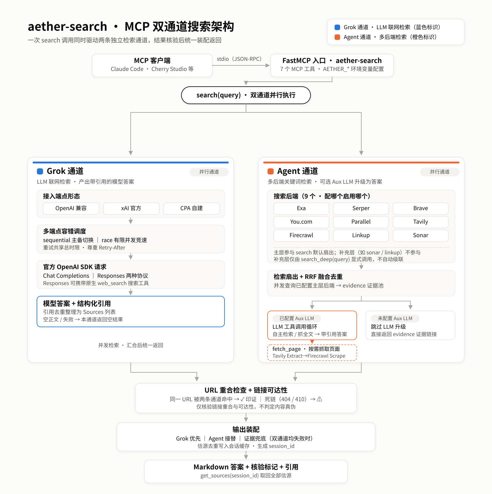

<p align="center">
  
</p>
<h1 align="center">aether-search</h1>
<p align="center">
  <a href="https://www.python.org/downloads/"></a>
  <a href="https://github.com/jlowin/fastmcp"></a>
</p>
<p align="center">
  <a href="README.md">English</a> | <strong>简体中文</strong>
</p>

aether-search 是一个基于 [FastMCP](https://github.com/jlowin/fastmcp) 的 MCP 搜索服务器，为 MCP 客户端（Claude Code、Cherry Studio 等）提供网络搜索与图片检索工具。一次 `search` 调用对**已配置且可用的通道并行执行**：

- **Grok 通道**：经 OpenAI 兼容 / xAI / CPA 端点调用 LLM 联网搜索，产出带引用的模型答案；
- **Agent 通道**：扇出多个搜索 API 后端（10 个可选），RRF 融合去重得到证据池；配置 Aux LLM 时进一步通过工具调用产出带引用答案，未配置时直接返回证据链接；
- **图片检索**：独立的 `search_images` 工具，向已配置的图片后端并行请求，返回图片直链、缩略图、来源页与尺寸。

两路结果汇合后做 URL 互证与死链探测，再统一装配返回。三个配置维度（Grok 端点 / 搜索后端 / Aux LLM）相互独立，配置哪个启用哪个，未配置的自动跳过；至少需配置 Grok 端点或一个主层搜索后端（已配置后端全部归入补充层时，Agent 通道不启用）。

## 架构



- **Grok 通道**：OpenAI 兼容 / xAI 官方 / CPA 自建端点，经官方 OpenAI SDK 走 Chat Completions 或 Responses 协议（Responses 可携带原生 `web_search`）；多端点支持 `sequential`（主备）或 `race`（有限并发竞速），重试共享总时限。
- **Agent 通道**：起步检索无条件扇出已配置的主层后端并做 RRF 融合，得到 evidence 证据池；若配置了 Aux LLM 且端点支持 function calling，则进入工具调用循环（`search_multi` 追加检索、`fetch_page` 抓取全文），由 LLM 自主决定检索与收手时机；超步数 / 超时 / 异常时用已有证据收尾。
- **页面抓取**：Agent LLM 的 `fetch_page` 与 `web_fetch` 工具共用同一抓取实现（DeepSeek Fetch → Tavily Extract → Firecrawl Scrape）；`web_fetch` / `web_map`（Tavily Map）是可独立调用的 MCP 工具，Agent 的工具集不含 map。
- **核验**：两通道返回后，引用做跨通道互证（同一 URL 两路命中标记 ✓），并对展示链接做可达性探测（404 / 410 标 ⚠）；仅核验链接本身，不判定内容真伪。
- **装配**：Grok 有正文则 Grok 为主，附加 Agent 检索证据；Grok 空正文则 agent 接替；双失败则以证据链接兜底；全部未配置时返回配置错误。
- **信源缓存**：每次 search 的全部信源（引用 + 证据）去重后写入会话缓存，并返回 `session_id`，可由 `get_sources` 取回。
- **后端分层**：默认全部已配置后端进主层参与 `search` 扇出；`AETHER_FALLBACK_BACKENDS` 指定的补充层（如 `sonar,linkup`）不参与默认扇出，仅由 `search_deep` 显式调用——`search` 不会自动级联到补充层，主层结果偏少时只输出提示，是否调用 `search_deep` 由上层决定。
- **图片检索**：`search_images` 独立于双通道，向所有支持图片的已配置后端（Serper / Brave / Parallel / Tavily / Firecrawl / Linkup）并行请求，按 URL 去重、轮询合并后返回图片直链、缩略图、来源页与尺寸。

## 搜索后端价格与额度

> **数据说明**：下表为 2026-09-12 核对的各服务官方定价页内容；个别促销性额度（如 Serper 免费次数）在当前页面未能确认，已在对应行注明。实际以官网当前公示为准。各服务计费单位不同（按次 / 按请求 / 按 credit / 按 token），相互之间不做换算。

| 服务 | 通道角色 | 免费额度 | 付费价格 | 计费单位 | 官方价格页 |
|---|---|---|---|---|---|
| xAI Grok | 主通道（LLM 答案） | 按供应商 / 账户政策 | 按所选模型与搜索工具计费，价格随模型 / 工具变动 | Token + 工具调用 | [docs.x.ai](https://docs.x.ai/developers/models) |
| DeepSeek | Agent + 抓取 | 指南未列免费额度 | Search / Fetch 均为 ¥5/1k 次有结果的成功请求（2026-11-01 补充） | 按请求 | [官方指南](https://api-docs.deepseek.com/zh-cn/guides/search) |
| You.com | Aux | $100 起始额度；官网另列 100 次/日免费入口（本项目连接器仍需配置 key） | Search $5/1k calls（1–100 结果同价） | 按次 | [you.com/pricing](https://you.com/pricing) |
| Parallel | Aux | 官网列每月最多 5,000 次免费、注册与月度额度（最高 $80 注册 + $5/月；资格与叠加规则未说明） | $1/1k（Turbo/Fast，10 结果）；$5/1k（Basic/Advanced）；额外结果 $1/1k 条 | 按请求 | [parallel.ai/pricing](https://parallel.ai/pricing) |
| Exa | Aux | $20 注册 + $10/月 credit | Search $7/1k（含 10 结果）；每加 1 结果 +$1/1k | 按请求 | [exa.ai/pricing](https://exa.ai/pricing) |
| Serper | Aux | 旧资料记录 2,500 次；本轮页面未确认数量与周期，以注册页为准 | $50/50k credits（$1/1k）起；高档 $0.75–$0.30/1k；credits 6 个月有效 | 按请求（credits） | [serper.dev](https://serper.dev) |
| Linkup | Aux | 4,000 次免费查询（官网当前页未标明刷新周期） | Search $0.005–0.006/次 | 按次 | [linkup.so/pricing](https://www.linkup.so/pricing) |
| Tavily | Aux + 抓取 | 1,000 credits/月 | PAYG $0.008/credit | 按 credit | [tavily.com/pricing](https://tavily.com/pricing) |
| Firecrawl | Aux + 抓取 | 1,000 credits/月 | Search 2 credits/10 结果；付费为订阅制：Hobby $16/月（年付，5,000 credits）、Standard $83/月（年付，100,000 credits），无按量付费 | 订阅 + credit | [firecrawl.dev/pricing](https://www.firecrawl.dev/pricing) |
| Brave | Aux | $5 月度额度（免费方案需绑卡做反欺诈验证） | Search $5/1k requests | 按请求 | [brave.com/search/api](https://brave.com/search/api/) |
| Perplexity Sonar | Aux | 定价页未列统一免费额度 | sonar：$1/1M 输入 + $1/1M 输出；搜索请求 $5 / $8 / $12 每 1k（按低 / 中 / 高搜索上下文） | Token + 按请求 | [docs.perplexity.ai](https://docs.perplexity.ai/guides/pricing) |

DeepSeek / Tavily / Firecrawl 的 key 同时驱动后端检索与 `web_fetch` 的页面抓取；`web_map` 仅使用 Tavily。各后端的申请步骤与环境变量见 [`docs/BACKENDS.md`](docs/BACKENDS.md)（该文档为 2026-07 记录，价格以上表为准）。

## 检索质量参考（第三方基准）

> [AIMultiple 第三方评测](https://aimultiple.com/agentic-search)：100 条英文 AI/LLM 相关查询，每接口取 5 条结果；原文注明 **2025-12 测评快照**（本轮已核对原文）。Agent Score = Mean Relevant × Quality，两项各满 5 分，理论满分 25。以下是对**第三方搜索 API** 的基准评分，不代表 aether-search 端到端表现，也不代表通用领域或中文查询的检索效果。

| 接口（基准原名） | Mean Relevant /5 | Quality /5 | Agent Score /25 | 95% CI | 延迟 |
|---|---|---|---|---|---|
| Brave | 4.28 | 3.48 | **14.89** | 13.80–15.93 | 669 ms |
| Firecrawl | 4.30 | 3.39 | **14.58** | 13.12–15.98 | 1,335 ms |
| Exa | 4.32 | 3.33 | **14.39** | 13.25–15.50 | ~1.2 s |
| Parallel（Pro 模式） | 4.32 | 3.29 | **14.21** | 13.07–15.47 | 13.6 s |
| Tavily | 4.18 | 3.27 | **13.67** | 12.62–14.76 | 998 ms |
| Parallel（Base 模式） | 4.18 | 3.23 | **13.50** | 12.38–14.66 | ~2.9 s |

- 原文统计结论：未发现前四名（Brave / Firecrawl / Exa / Parallel Pro）之间的统计显著差异，并报告 Brave 对 Tavily 的显著优势。
- 基准中的外部对照接口（本项目未接入）：Perplexity Search API 12.96（延迟 11 s 以上）、SerpAPI 12.28（~2.4 s）。注意 Perplexity 该项评的是其 Search API，不是本项目的 Sonar 连接器；SerpAPI 与 Serper 是不同服务。
- 上表为评测源对 Parallel 两种模式的分别评分；本项目 Parallel 连接器请求 `mode=advanced`，与基准两种模式的对应关系未在本次核验范围内。
- 本项目接入但无该基准可比数值的后端：You.com、Linkup、Serper、Sonar、DeepSeek、Grok。

## 安装与接入

- Python ≥ 3.11；依赖 `fastmcp` / `httpx` / `openai` / `pydantic` / `tenacity`（见 [`pyproject.toml`](pyproject.toml)）。
- 配置全部通过 `AETHER_*` 环境变量传入；也可放在运行时工作目录下的 `.env`（不入库）。
- 至少配置 Grok 端点或一个主层搜索后端 key；Aux LLM 与其余字段均可选。以下示例仅演示字段格式。

### 方式一：远程仓库（uvx）

`.mcp.json`（完整模板见 [`mcp.json.example`](mcp.json.example)）。`uvx` 从 GitHub 拉取并运行**已发布的远程代码**，其内容是该远程仓库的当前发布状态，与本地 checkout 中未推送的改动是两个独立来源：

```json
{
  "mcpServers": {
    "aether-search": {
      "command": "uvx",
      "args": ["--from", "git+https://github.com/maliaosaide/aether-search", "aether-search"],
      "env": {
        "AETHER_GROK_API_URL": "https://api.x.ai/v1",
        "AETHER_GROK_API_KEY": "<your-key>",
        "AETHER_GROK_MODEL": "<model-id>",
        "AETHER_EXA_API_KEY": "<your-key>"
      }
    }
  }
}
```

### 方式二：本地代码

在本地 checkout 上运行（控制台入口为 `aether-search`，即 `aether_search.server:main`）：

```bash
# uv：在仓库目录内解析依赖并启动
uv --directory <仓库绝对路径> run aether-search

# 或直接用 Python（在仓库根目录执行，将 src 加入模块路径）
PYTHONPATH=src python -m aether_search.server
```

对应 `.mcp.json` 写法：

```json
{
  "mcpServers": {
    "aether-search": {
      "command": "uv",
      "args": ["--directory", "/absolute/path/to/aether-search", "run", "aether-search"],
      "env": {
        "AETHER_GROK_API_URL": "https://api.x.ai/v1",
        "AETHER_GROK_API_KEY": "<your-key>",
        "AETHER_GROK_MODEL": "<model-id>",
        "AETHER_EXA_API_KEY": "<your-key>"
      }
    }
  }
}
```

## 配置项

完整字段见 [`.env.example`](.env.example)（与 `config.py` 一一对应）。布尔与数值以字符串形式书写（如 `"true"`、`"10"`）。

**Grok 通道**（OpenAI 兼容 / xAI 官方 / CPA）
- `AETHER_GROK_API_URL` / `_API_KEY` / `_MODEL`：单端点配置；URL 含 `/v1` 等版本前缀，模型名原样传给上游。
- `AETHER_GROK_PROVIDER`：`auto`（默认）/ `openai` / `xai` / `cpa`；自动识别仅针对精确主机名 `api.x.ai`。
- `AETHER_GROK_API_FORMAT`：`auto` / `chat_completions` / `responses`；auto 下 xAI 走 Responses，其余走 Chat。
- `AETHER_GROK_ENDPOINTS`：多端点 JSON，每项 `url,key,model?,label?,provider?,api_format?,search_mode?`，设置后覆盖单端点。
- `AETHER_GROK_FAILOVER`：`sequential`（默认）/ `race`；竞速并发上限 `AETHER_GROK_MAX_CONCURRENCY`（默认 `2`）。
- `AETHER_GROK_SEARCH_MODE`：空值或 `auto` 在 xAI 上请求原生搜索，其他网关不附加工具；`on` 显式请求 Responses 搜索工具；`off` / `none` 不携带工具（Chat 不支持 `on`）。
- `AETHER_GROK_TIMEOUT`（默认 `60` 秒，整通道）/ `AETHER_GROK_REQUEST_TIMEOUT`（默认 `45` 秒，单次尝试）。
- 字段细则见 [Grok 通道文档](docs/GROK.md)。

**Aux LLM**（OpenAI 兼容，可选）
- `AETHER_LLM_API_BASE` / `_API_KEY` / `_MODEL`：配置后 agent 通道经工具调用产出带引用答案；端点须支持 function calling。
- `AETHER_LLM_REWRITE`（默认 `true`）：是否把查询改写为子查询。

**搜索后端**（10 个，配置 key 即启用）
- `AETHER_<NAME>_API_KEY`，NAME ∈ `PARALLEL` / `BRAVE` / `EXA` / `SERPER` / `LINKUP` / `YOUCOM` / `SONAR` / `TAVILY` / `FIRECRAWL` / `DEEPSEEK`；URL 均有官方默认值。
- **仅用 DeepSeek**：配置 `AETHER_DEEPSEEK_API_KEY` 即可搜索、抓取，无需 Grok。搜索词最多 128 字符；`AETHER_DEEPSEEK_API_URL` 默认 `https://api.deepseek.com`（不带 `/v1`）。需要 Agent 自动补搜与生成答案时，再配置上面的 Aux LLM；[配置示例](docs/BACKENDS.md#10-deepseek-search--fetch)。

**分层 / Agent / 核验**
- `AETHER_FALLBACK_BACKENDS`：补充层后端名（逗号分隔），不进 `search` 默认扇出。
- `AETHER_AGENT_MAX_STEPS`（默认 `6`）、`AETHER_AGENT_TIMEOUT`（默认 `90` 秒，含起步检索）。
- `AETHER_VERIFY`（默认 `true`）、`AETHER_VERIFY_TIMEOUT`（默认 `2.5` 秒）。
- 其他：`AETHER_FANOUT` / `AETHER_MAX_VARIANTS` / `AETHER_TOP_K` / `AETHER_RRF_K` / `AETHER_MAX_CONCURRENCY` 等，见 `.env.example`。

### 配置组合行为

| Grok | 主层后端（≥1） | Aux LLM | 行为 |
|---|---|---|---|
| ✓ | ✓ | ✓ | 双通道并行 + agent 带引用答案 + 互证 |
| ✓ | ✓ | ✗ | Grok 答案 + evidence 链接 |
| ✓ | ✗ | * | 仅 Grok 通道 |
| ✗ | ✓ | ✓ | agent 带引用答案 |
| ✗ | ✓ | ✗ | agent evidence 链接 |
| ✗ | ✗ | * | 返回配置错误 |

## MCP 工具

| 工具 | 作用 |
|---|---|
| `search(query, platform="", sources_mode="inline")` | 双通道并行搜索（主层后端扇出）；`sources_mode="session"` 时正文仅保留答案与核验块，信源经 `get_sources` 获取 |
| `search_deep(query, platform="")` | 补充层检索（`AETHER_FALLBACK_BACKENDS` 指定的后端）；由上层根据 `search` 偏少提示决定是否调用 |
| `search_images(query, count=10)` | 图片检索：向已配置的 Serper / Brave / Parallel / Tavily / Firecrawl / Linkup 并行请求，去重轮询合并，返回图片直链、缩略图、来源页与尺寸 |
| `get_sources(session_id)` | 取回指定会话的全部信源（带 ✓ ⚠ ? 核验标记） |
| `web_fetch(url)` | 抓取单页为 Markdown（DeepSeek Fetch → Tavily Extract → Firecrawl Scrape 降级） |
| `web_map(url, ...)` | 站点结构映射（Tavily Map） |
| `toggle_builtin_tools(action)` | 开关调用方项目 `.claude/settings.json` 中 Claude 内置的 WebSearch / WebFetch（`on` / `off` / `status`） |
| `get_config()` | 配置状态（key 脱敏）+ 逐端点 `/models` 连通性诊断 |

## 图片搜索

`search_images` 独立于 Grok / Agent 双通道，直接向所有已配置的图片后端并行请求，按图片 URL 去重后轮询合并。

```text
search_images(query: str, count: int = 10) -> Markdown
```

- `query`：想找的图片内容，例如 `"NVIDIA B300 GPU"`、`"golden gate bridge sunset"`；
- `count`：合并后返回的最大数量（1–50，默认 10）；每个后端各自请求至多 `count` 条，再统一去重合并；
- 返回：标题、图片直链、缩略图（如有）、来源页、尺寸与后端名；
- 触发：用户说“找图 / 配图 / 图片素材 / 搜图片 / find pictures / image assets”等时，MCP 客户端会根据工具描述自动选择；也可以显式说“用 `search_images` 搜……”。

### 支持图片检索的后端

| 后端 | 调用方式 | 环境变量 | 返回内容 |
|---|---|---|---|
| Serper | `POST /images` | `AETHER_SERPER_API_KEY` | `imageUrl` / `thumbnailUrl` / `link` / 宽高 |
| Brave | `GET /images/search` | `AETHER_BRAVE_API_KEY` | 原图 `properties.url` / 缩略图 / 宿主页 |
| Parallel | `POST /v1/images/search` | `AETHER_PARALLEL_API_KEY` | `image_url` / `source_page_url` / 宽高 |
| Tavily | `POST /search` + `include_images` | `AETHER_TAVILY_API_KEY` | `images[].url` / `description` |
| Firecrawl | `POST /search` + `sources:["images"]` | `AETHER_FIRECRAWL_API_KEY` | `imageUrl` / 来源页 / 宽高；支持 `imagesize:`、`larger:` 等尺寸操作符 |
| Linkup | `POST /search` + `includeImages` | `AETHER_LINKUP_API_KEY` | `type:"image"` 的 `name` / `url` |

配置任意一个 key 即自动启用对应后端；配置多个则并行扇出，未配置的后端静默跳过。

> Exa 的 `contents.extras.imageLinks` 属于网页配图抽取，不是图片搜索，本项目未接入；You.com / DeepSeek / Sonar / Grok 不提供图片检索能力。

> `search_images` 会使用所有已配置的图片后端，包括 `AETHER_FALLBACK_BACKENDS` 中指定的后端；它是显式调用的独立工具，不参与主层 / 补充层划分。

> 图片检索只返回图片 URL 与元数据，不下载图片、不做 OCR 或内容识别。

## 局限

- 依赖外部 API key：Grok 端点、搜索后端、Aux LLM 均需自行申请配置，项目不内置免费额度。
- 延迟取决于启用的后端、上游响应速度与 Agent 工具调用轮数；上方基准表中的延迟为第三方 API 的单独测量值，不代表本项目的端到端耗时。
- 工具调用要求 Aux LLM 端点支持 OpenAI 风格 `tools` 参数；不支持时依次尝试 LLM 摘要，再退回证据链接。
- 经第三方中转的 Grok 端点可能返回空正文；多端点容错可配置备用端点。
- 按量付费或配额受限后端可经 `AETHER_FALLBACK_BACKENDS` 归入补充层，避免每次 `search` 消耗。
- 核验只覆盖链接重合与可达性，不判定引用内容的真伪。
- 图片检索只返回图片 URL 与元数据，不下载图片、不做 OCR 或内容识别；支持的后端与限制见上文“图片搜索”。
- 测试范围：Grok 通道含离线单元 / 回归测试与进程内 MCP 集成测试；DeepSeek 覆盖搜索、抓取降级、Agent 独立运行及工具调用历史；图片检索覆盖六个后端解析、去重合并与工具入口。不等于所有后端或检索质量均已验证。

## 开发与测试

离线测试使用标准库 `unittest` 与模拟 HTTP 传输，不读取用户 `.env`、不调用真实外部服务（Windows / Git Bash，在仓库根目录执行）：

```bash
PYTHONPATH=src .venv/Scripts/python.exe -m unittest discover -s tests -p 'test_grok.py' -v
PYTHONPATH=src .venv/Scripts/python.exe -m unittest discover -s tests -p 'test_grok_protocol.py' -v
PYTHONPATH=src .venv/Scripts/python.exe -m unittest discover -s tests -p 'test_grok_integration.py' -v
PYTHONPATH=src .venv/Scripts/python.exe -m unittest discover -s tests -p 'test_deepseek.py' -v
PYTHONPATH=src .venv/Scripts/python.exe -m unittest discover -s tests -p 'test_images.py' -v
```

## 相关文档

- [`docs/BACKENDS.md`](docs/BACKENDS.md) — 后端申请入口、额度与配置示例（2026-07 记录）
- [`docs/GROK.md`](docs/GROK.md) — Grok 通道字段细则、三种接入示例与离线测试说明
- [`.env.example`](.env.example) / [`mcp.json.example`](mcp.json.example) — 配置模板

## 许可证

MIT，见 [LICENSE](LICENSE)。

## 友情链接 / Friendly Links

- [LINUX DO](https://linux.do/) — 一个新的理想型技术社区。

## Star History

[](https://star-history.com/#maliaosaide/aether-search&Date)
